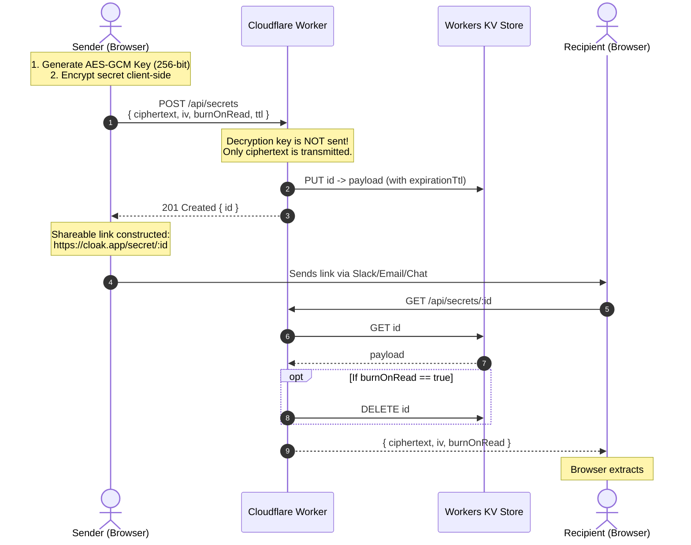

# Cloak — Architecture & Implementation Document
**A Minimal, Zero-Knowledge Ephemeral Secret Sharing Platform**

---

## 1. Executive Summary

**Cloak** is a lightweight, secure secret-sharing utility designed to transmit sensitive information (passwords, credentials, API keys, private notes) over ephemeral, self-destructing links.

### Key Goals
- **Minimal & Simple**: Built directly on **Cloudflare Workers** and **Cloudflare Workers KV** with near-zero runtime overhead and no complex database requirements.
- **Zero-Knowledge Encryption**: All secrets are encrypted client-side in the browser using Web Crypto API (`AES-GCM-256`) before transmission. The decryption key resides exclusively in the URL fragment (`#hash`) and is never sent to Cloudflare or logged anywhere on the server.
- **Configurable Ephemerality (TTL)**: Users configure secret expiration (e.g., 5 minutes, 1 hour, 24 hours, 7 days) paired with Cloudflare KV's native `expirationTtl`.
- **Burn-on-Read**: Secrets can optionally or by default self-destruct immediately after first retrieval.

---

## 2. System Architecture



---

## 3. Security Model (Zero-Knowledge)

### Why URL Fragment (`#`) Encryption?
In RFC 3986, the fragment identifier component (everything after `#`) is strictly handled by the user agent (browser) and is **never included in HTTP request headers**.

1. **Encryption at Rest & in Transit**: Cloudflare Workers only ever handles the encrypted ciphertext and initialization vector (`iv`).
2. **Server-Blind**: Even a compromised worker script, network intercept, or administrative inspection of Cloudflare KV will only reveal meaningless ciphertexts.
3. **Decryption on Arrival**: Only someone with the complete URL (including `#key`) can derive the cryptographic key and decrypt the payload.

### Cryptographic Primitives
- **Algorithm**: `AES-GCM` with a 256-bit randomly generated key (`crypto.getRandomValues`).
- **IV**: 12-byte cryptographically secure random Initialization Vector generated per secret.
- **Encoding**: Binary buffers are encoded in URL-safe Base64 or Hex for transport.

---

## 4. Technology Stack

| Layer | Component | Choice | Rationale |
| :--- | :--- | :--- | :--- |
| **Compute / API** | Edge Runtime | Cloudflare Workers | Sub-millisecond cold starts, global latency < 50ms, low cost. |
| **Storage** | Key-Value Store | Cloudflare Workers KV | Native TTL support (`expirationTtl`), automatic background eviction. |
| **Frontend** | UI & Crypto Engine | Vanilla HTML/CSS/JS (SPA) | Zero build-step dependencies, hyper-minimal, lightning-fast rendering. |
| **Tooling** | CLI & Deployment | Wrangler (`wrangler.jsonc` or `wrangler.toml`) | Standard Cloudflare development and deployment tool. |

---

## 5. Cloudflare KV Data Schema

- **Key Format**: `secret:<uuid_or_nanoid>` (e.g., `secret:c9f8a3e1-7d22-4a0b-92f5-d0c3e982a174`)
- **TTL Enforcement**: Cloudflare KV native parameter `expirationTtl: Math.min(Math.max(60, ttlSeconds), 604800)` (Min: 60 seconds, Max: 7 days).
- **Value (JSON)**:

```json
{
  "ciphertext": "p9A3V1...==",
  "iv": "k4J2Z0...==",
  "burnOnRead": true,
  "viewsRemaining": 1,
  "createdAt": 1729614510000,
  "expiresAt": 1729618110000
}
```

---

## 6. API Specification

### 1. Create Secret
- **Method**: `POST /api/secrets`
- **Request Body**:
  ```json
  {
    "ciphertext": "...",
    "iv": "...",
    "ttl": 3600,
    "burnOnRead": true
  }
  ```
- **Response**: `201 Created`
  ```json
  {
    "id": "c9f8a3e1-7d22-4a0b-92f5-d0c3e982a174",
    "expiresAt": 1729618110000
  }
  ```

### 2. Retrieve Secret
- **Method**: `GET /api/secrets/:id`
- **Response**: `200 OK`
  ```json
  {
    "ciphertext": "...",
    "iv": "...",
    "burnOnRead": true,
    "expiresAt": 1729618110000
  }
  ```
- **Error Responses**:
  - `404 Not Found`: Secret does not exist, has expired, or was already burned.
  - `410 Gone`: Explicitly burned/expired.

### 3. Early Revocation / Manual Burn
- **Method**: `DELETE /api/secrets/:id` (Optional: authenticated with an owner deletion token if required).

---

## 7. User Interface & Experience (UI/UX)

The user interface will be embedded or served directly as static assets from the Worker:
1. **Create View**:
   - Modern, sleek dark theme with a clean card container.
   - Textarea for secret input (supports passwords, notes, JSON, private keys).
   - TTL dropdown: 5 Minutes, 1 Hour, 24 Hours, 7 Days.
   - Toggle: "Burn after first read" (enabled by default).
   - "Generate Secure Link" button.
2. **Success View**:
   - One-click "Copy Link" button with visual feedback.
   - Warning banner: *"This link contains the decryption key in the fragment. Do not lose it; we cannot recover it."*
3. **Recipient View**:
   - Clean preview card with confirmation: *"Click to reveal secret (will self-destruct immediately)"*.
   - Plaintext output with syntax copy and countdown timer until destruction.

---

## 8. Project Structure

```
cloak/
├── src/
│   ├── index.ts          # Cloudflare Worker entry point (Router + KV handler)
│   ├── crypto.ts         # Server-side validation & utility helpers
│   └── public/           # Static frontend assets (or inline template)
│       ├── index.html    # Single-page UI
│       ├── app.js        # Web Crypto (AES-GCM) + API client
│       └── style.css     # Premium dark theme styling
├── wrangler.toml         # Cloudflare Workers configuration
├── package.json          # Minimal devDependencies (wrangler, typescript)
├── tsconfig.json         # TypeScript configuration
└── IMPLEMENTATION.md     # This document
```

---

## 9. Implementation Milestones

- [x] **Milestone 1**: Initialize repository with `package.json`, TypeScript, and `wrangler.toml` with KV binding.
- [x] **Milestone 2**: Build Cloudflare Worker backend API endpoints (`POST /api/secrets`, `GET /api/secrets/:id`).
- [x] **Milestone 3**: Build client-side cryptographic module with `window.crypto.subtle` (key generation, AES-GCM encryption/decryption, URL hash packing).
- [x] **Milestone 4**: Craft the frontend interface (Dark mode, responsive, accessible, animated micro-interactions).
- [ ] **Milestone 5**: Local testing with Wrangler KV simulation and edge verification.
- [ ] **Milestone 6**: Advanced Security Layer — Password protection with Salt & Hash (PBKDF2 / Key Derivation).
